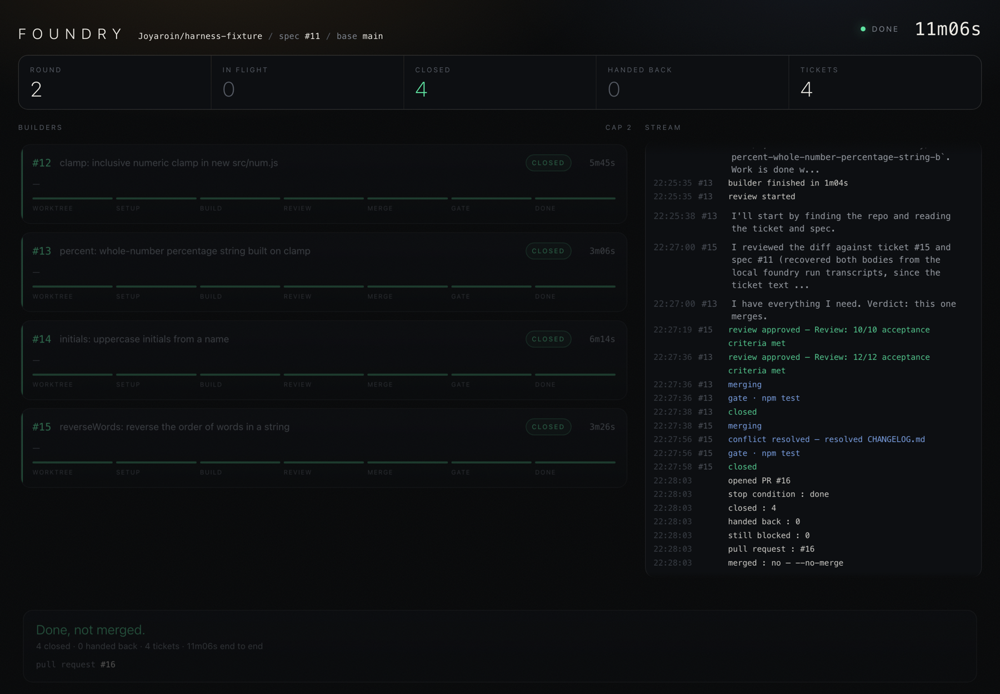

# foundry

**One idea in, a reviewed and merged pull request out.**

[](https://github.com/Joyaroin/foundry/actions/workflows/ci.yml)
[](LICENSE)


`/foundry` grills you on an idea until the design is settled, and writes the spec. From there it
runs on its own: it breaks the spec into dependency-aware tickets and builds them test-first, in
parallel where they are independent. A second model reviews each ticket before it lands. If the
whole queue comes out green, foundry merges the PR itself.

The interesting part is the split. The conversation is a [Claude Code](https://claude.com/claude-code)
skill, because grilling needs a human. The rest is a TypeScript program on the
[Claude Agent SDK](https://code.claude.com/docs/en/agent-sdk). The model writes the tickets and the
code, and everything that decides what *happens* to them is ordinary code: scheduling, concurrency,
stop conditions, what counts as green, the merge. A model can't skip an `if` statement.



<sub>A real run, replayed in `foundry dashboard`: spec #11 on
<a href="https://github.com/Joyaroin/harness-fixture">harness-fixture</a>. 4 tickets in 2 rounds,
each one reviewed before it landed, in 11 minutes end to end.</sub>

## Proven on real runs

| Date | Spec | What happened | Result |
|---|---|---|---|
| 2026-08-31 | text helpers | 3 tickets: 2 built in parallel, 1 held behind its blocker until round 2 | [PR #8](https://github.com/Joyaroin/harness-fixture/pull/8) opened, CI green, 11 tests |
| 2026-10-29 | a messy backlog, via `foundry plan` | 6 existing issues: folded a duplicate pair, added a missing dependency, replaced a wrong one, skipped a vague issue with the question it needs answered, then built the other 4 in 2 rounds | [PR #24](https://github.com/Joyaroin/harness-fixture/pull/24) opened, CI green, 30 tests |
| 2026-10-29 | number helpers | 4 tickets: one held back a round for sharing a file, all 4 reviewed and approved, both CHANGELOG collisions resolved | [PR #16](https://github.com/Joyaroin/harness-fixture/pull/16) **merged by foundry**, CI green on `main`, 18 tests |

Both runs were against a fixture repo with real CI, which requires a CHANGELOG and bans
`console.log`. Nothing has run yet against a project with heavy dependencies or a database. See
[Status](#status).

## How it works

```
  ATTENDED  ──────────────────────────┐   UNATTENDED ──────────────────────────────────
  0 preflight → 1 grill → 2 spec ─────┤── 3 tickets → 4 build loop → 5 PR → merge → stop
                              ▲       │                    │
                          the only gate          build → review → merge → gates
```

1. **Grill.** Questions come in rounds, and each round asks only what can be answered now, without
   guessing at answers still to come.
2. **Spec.** Published as a GitHub issue. It includes a *Shared Interfaces* section with the exact
   names and signatures more than one ticket will touch, so parallel builders can't each invent their
   own. Approving the spec is the last thing foundry ever asks you.
3. **Tickets.** One model call returns a schema-validated breakdown. Code checks it and publishes it
   as sub-issues with native GitHub dependency edges.
4. **Build loop.** Each round builds the tickets with no open blockers. Each gets its own git worktree
   and runs in parallel up to a cap, and two tickets that declared the same files never share a
   round. A finished ticket is reviewed, merged into the run's branch, and checked with the repo's
   own test commands.
5. **Ship.** It opens the PR, and merges it only if all four merge conditions below hold.

### The model decides content; code decides everything else

| Decision | Who makes it |
|---|---|
| What the tickets are, and their dependency edges | model, schema-enforced |
| The code inside one ticket | model, one builder per worktree |
| Whether a built ticket is good enough | model can **only reject**; code rejects on any unmet criterion, a blocking finding, or a missing verdict |
| Which tickets run, and which run together | code (`frontier.ts`) |
| Whether work is green | code: the repo's declared test commands, by exit code |
| When the loop stops, and whether the PR merges | code: three stop conditions, four merge conditions |

The full table, with the file behind each row, is in [`orchestrator/README.md`](orchestrator/README.md).

## What running it taught it

None of these showed up in type checks or code review. Each was found by running the pipeline, and
each is now handled in code, with the reasoning written next to it:

- **GitHub's issue-dependency summary is eventually consistent.** A freshly written edge read back as
  0, 0, then 1, so a blocked ticket could look ready and get built before its blocker existed.
  Ticket writing now waits until every edge it wrote is visible, and fails loudly after 60s.
- **Parallel builders collide.** Every builder in a round starts from the same commit, so a file they
  all must create (a CHANGELOG) conflicts on the second merge. Foundry resolves those, then checks
  the result the same way as a clean merge. Tickets that edit the same source files are now kept out
  of the same round altogether.
- **"No CI checks" right after a push means "not yet".** CI registers checks a few seconds later, so
  reading the status once would merge before CI had started. "None" is believed only after holding
  for a minute.
- **A plain-looking command handed agents nothing.** Piped, `gh issue view N --comments` prints the
  comments without the issue itself. Builders and reviewers had been working around an empty
  command, one by reading old session logs off the disk. The program now fetches each issue and
  puts it in the prompt.
- **Isolating the SDK from the machine also hid the repo's own `CLAUDE.md`** from every builder.
  Probed with a planted marker, then fixed.
- **Cleanup once deleted a whole directory of worktrees.** One project keeps 28 hand-made worktrees
  there, two of them locked. Foundry now removes only the ones it created. `foundry cleanup` sorts
  the rest before touching anything, and never removes a worktree with uncommitted or locked work.

## Quick start

You need Node 20+, an authenticated [`gh`](https://cli.github.com), and Claude Code.

```bash
git clone https://github.com/Joyaroin/foundry.git
cd foundry/orchestrator && npm install && npm link   # puts `foundry` on your PATH
```

```text
claude
> /plugin marketplace add Joyaroin/foundry
> /plugin install foundry@foundry
```

Then add a `foundry.config.json` to the repo you want to build in, declaring what "green" means:

```json
{ "verify": ["npm run typecheck", "npm test"], "maxParallel": 3 }
```

Then run `/foundry <the thing you want built>` from inside that repo. For a repo's first run, add
`--no-merge` so it stops at an open PR.

Being logged in to Claude Code is enough: the SDK uses those credentials, so a local run draws on
your subscription. `CLAUDE_CODE_OAUTH_TOKEN` (from `claude setup-token`) and `ANTHROPIC_API_KEY` also
work. Preflight says which one it found.

### What it needs from the repo it builds in

All of these are checked before anything runs, and the run refuses if any fails:

- the working tree is clean, and `.claude/` is gitignored (builder worktrees live there)
- `gh` is authenticated, and GitHub issue dependencies are readable (they are how blocked tickets
  are told apart from ready ones); the two labels it uses are created if missing
- `foundry.config.json` declares the gate commands. The program will not guess what "green" means.

A repo whose tests share a database or other external resource can give each builder its own copy.
See [per-builder isolation](orchestrator/README.md#per-builder-isolation).

### Already have issues? Skip the conversation

```bash
foundry plan            # assess every open issue; print the plan; change nothing
foundry plan --apply    # write exactly that plan to GitHub
foundry run <plan>      # build it
```

`foundry plan` reads the repo's open issues and its code. It folds duplicates into the oldest
(appending their full text, never rewriting it), works out what depends on what and which files each
issue touches, and skips anything it can't build without inventing a decision, saying what's missing.
Nothing changes on GitHub until you've read the printout, rounds and removed links included, and run
`--apply`.

## When it merges, and when it doesn't

A clean **done** run merges its own PR with `--merge`, so each ticket's commit survives in history.
It merges only when all four of these hold:

1. every ticket closed (reviewed, merged and green), and none handed back
2. the repo's gates are green on the run's branch after the last merge
3. `gh pr checks` is green (a repo with no CI passes after a minute of seeing none)
4. you did not pass `--no-merge`

A **deadlock** (the only tickets left depend on one that failed) or a **stall** (two rounds closed
nothing) never merges. The PR stays open, and the report says what stopped it. Foundry never uses
`--admin`, never forces, and never retries a refused merge. Branch protection is a decision someone
already made.

**A failed ticket is not retried.** It is handed back as `ready-for-human`, and the tickets behind it
stop, loudly. A loop that retries spends its whole budget on the one thing that cannot work. Fix it
by hand, re-label it, and run again: the run resumes with the same tickets and the same PR.

## Repository layout

| Path | What it is |
|---|---|
| [`plugin/skills/foundry/`](plugin/skills/foundry/SKILL.md) | the attended half: preflight, grilling, the spec gate, the hand-off |
| [`plugin/skills/`](plugin/skills) `grilling` `to-spec` `to-tickets` `implement` `tdd` | the pipeline stages and the testing discipline builders follow |
| [`orchestrator/src/build.ts`](orchestrator/src/build.ts) | the round loop, landing work, the stop conditions |
| [`orchestrator/src/frontier.ts`](orchestrator/src/frontier.ts) | the whole scheduler: what is buildable, and what can share a round |
| [`orchestrator/src/review.ts`](orchestrator/src/review.ts) | the reviewer that can only say no |
| [`orchestrator/src/tickets.ts`](orchestrator/src/tickets.ts) | spec to tickets: one agent call, then publishing in code |
| [`orchestrator/src/plan.ts`](orchestrator/src/plan.ts) | `foundry plan`: existing issues to a checked, printed, then applied plan |
| [`orchestrator/src/ship.ts`](orchestrator/src/ship.ts) | the PR and the merge decision |
| [`orchestrator/src/dashboard.ts`](orchestrator/src/dashboard.ts) | `foundry dashboard`, the live view above |
| [`docs/field-guide.html`](docs/field-guide.html) | the operator's guide |

## Development

```bash
cd orchestrator
npm run typecheck
npm test          # the scheduler, the dependency-edge rule, the review verdict, the merge decision
```

CI runs both on every push. The parts that talk to GitHub, git or a model are tested by running the
pipeline against [harness-fixture](https://github.com/Joyaroin/harness-fixture), and each such run
is recorded in [`CLAUDE.md`](CLAUDE.md).

## Status

**v0.3.0.** Proven end to end twice on the fixture, including a self-merge. Not yet exercised:

- a repo with heavy dependencies or a database
- a merge refused by branch protection
- the reviewer rejecting a ticket inside a full run (it has rejected in a scratch repo)

Two constraints shape the code. The first is comprehensibility. Foundry's predecessor was a
1,889-line pipeline that got deleted unused because its own author could not maintain it, so this one
avoids clever control flow, and avoids abstractions that have only one caller. The second is determinism:
anything that decides the shape of a run lives in code, not in a prompt.

## License

[MIT](LICENSE)
